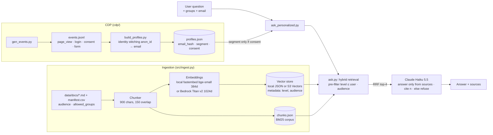

# customer-tech-ai-lab

## 1. What this is (and isn't)

A **small prototype** of a permission-aware RAG assistant with CDP-driven personalization, built over **our own / fictional content** (`data/docs/`, synthetic events in `data/events.jsonl`).

- **It is:** a working end-to-end demo of hybrid retrieval (vector + BM25), security trimming by group, grounded answers with citations and refusals, and personalization driven by a unified, consent-aware customer profile.
- **It is not:** production software. No real customer data, no hardening, no SLAs.

## 2. Architecture



Security trimming happens **before** scoring (filter on `level` and `audience`), so restricted chunks never reach the model. Groups come from the caller's identity, never from the prompt.

## 3. Results

**Evaluation** (`python src/eval.py`, golden set `eval/golden-set.csv`, 7 questions):

| Metric | Result |
|---|---|
| hit@4 (expected source in the top-4) | **4/4** |
| Correct refusals (out-of-scope or not permitted) | **3/3** |
| Leaks (restricted source returned to an unauthorized group) | **0** |

**Personalization tests** (`python src/ask_personalized.py "How do I build a block?" --email …`):

| # | Case | Profile | Outcome |
|---|---|---|---|
| 1 | Known user, consented, matching segment | `user6@example.com` → developer | Personalization **ON**; answer from `eds-blocks.md` with developer framing |
| 2 | Known user, **no consent** | `user9@example.com` → developer | Personalization **OFF**; generic answer, still correct |
| 3 | Known user, consented, other segment | `user0@example.com` → marketer | Personalization **ON**; audience filter excludes developer docs → **refuses** instead of guessing |
| 4 | Unknown email | `nobody@example.com` | No profile → personalization **OFF**; generic answer |

Case 3 shows that the segment is used as a hard filter: it is safe (no hallucination), but it hides relevant content. In production the segment should change ranking and wording, not decide which documents can be seen.

## 4. Changes needed towards production readiness

- **Security:** least-privilege IAM roles per component; secrets in AWS Secrets Manager (not `.env`).
- **Ingestion:** incremental ingestion with indexers / change detection instead of full re-index.
- **Quality:** continuous evaluation in CI on a larger golden set, plus online feedback.
- **Guardrails:** content safety and prompt-injection detection on inputs and retrieved content.
- **Observability:** tracing, latency, and **cost per query** dashboards.
- **CDP:** a real CDP with probabilistic identity resolution (not only deterministic login stitching).
- **Consent:** auditable consent records (who, when, what purpose, versioned).
- **Events:** streaming via Kinesis or EventBridge instead of a JSONL file.
- **Activation:** expose answers and segments through API Management (auth, quotas, versioning).

## 5. Limits

- **Synthetic data:** fictional documents and generated events (15 known users, 10 anonymous visitors).
- **Keys in `.env`:** credentials are loaded from a local `.env` file.
- **No load testing:** single-user runs only; small golden set (7 questions).
- Only the documents listed in `data/manifest.csv` are indexed (`adr-examples.md` and `dxp-crm-integration.md` are not).

## Run it

```bash
uv venv --python 3.12 .venv && uv pip install --python .venv/bin/python -r requirements.txt
cp .env.example .env               # set ANTHROPIC_API_KEY, EMBED_BACKEND=local, VECTOR_BACKEND=local
.venv/bin/python src/ingest.py     # chunk + embed + index
.venv/bin/python cdp/gen_events.py && .venv/bin/python cdp/build_profiles.py
.venv/bin/python src/eval.py
.venv/bin/python src/ask_personalized.py "How do I build a block?" --email user6@example.com
```

Python 3.12 is required on Intel Macs: `onnxruntime` (used by `fastembed`) has no build there for Python 3.13 or later.
